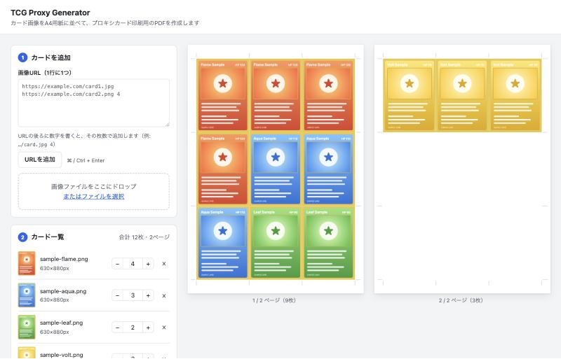

# tcg-proxy-generator

カード画像をA4用紙に並べて、プロキシカード印刷用のPDFを作成するブラウザアプリです。
Node.js だけで動き、`npm install` は不要です。



<sub>※ スクリーンショットのカードは説明用のサンプル画像です。</sub>

## サーバーの起動と停止

必要なもの: Node.js 20 以上（`node --version` で確認できます）

```bash
git clone https://github.com/rsuet/tcg-proxy-generator.git
cd tcg-proxy-generator
node server.js
```

`npm start` でも起動できます。ターミナルに `TCG Proxy Generator: http://localhost:3000` と表示されたら起動完了です。
停止するときは、ターミナルで `Ctrl + C` を押します。

ポート 3000 が使用中の場合は、別のポートを指定して起動します。

```bash
PORT=3001 node server.js
```

## 使い方

1. 上の手順でサーバーを起動する
2. ブラウザで <http://localhost:3000> を開く
3. カードを追加する
   - 画像URLを1行に1つずつ貼り付けて「URLを追加」を押す
   - URLの後ろに数字を書くと、その枚数で追加される（`https://example.com/card.jpg 4`、`… x4`、`4 https://…` のどれでもよい）
   - PC内の画像ファイルは、画面にドラッグ&ドロップするか「ファイルを選択」から追加する
   - 枚数はカード一覧の −/+ ボタンや数値欄で変更できる
4. 必要に応じて印刷設定を変える
5. 「PDFを作成」を押すと、PDFがダウンロードされる

印刷するときは、印刷ダイアログの倍率を **100%（実際のサイズ）** にしてください。
「用紙に合わせる」のままだと、カードが縮小されて実寸より小さくなります。

## 印刷設定

| 項目 | 内容 |
| --- | --- |
| カードサイズ | ポケモンカード・MTG など（63×88mm）、遊戯王（59×86mm）、または任意の幅・高さ |
| 倍率 | 印刷したカードが実寸とずれる場合の補正。プリンタの誤差やスリーブに合わせて調整する |
| 画像の合わせ方 | 伸縮してカードサイズに合わせる／縦横比を保って切り取る／縦横比を保って余白を付ける |
| トンボ | カードの境界の延長上、用紙の余白部分に切り取り位置の目印を引く |

設定と追加したURLはブラウザに保存され、ページを開き直しても残ります（ローカル画像は保存されません）。

## 出力されるPDF

- 用紙はA4縦。カードは隙間なく敷き詰め、用紙の中央に配置する（63×88mmなら3列×3行の9枚）
- カードの順番はカード一覧の順。同じカードは指定した枚数だけ続けて並ぶ
- 画像はJPEGに変換して埋め込む。解像度は元画像のままで、600dpi相当を超える場合だけ縮小する

## 仕組み

ブラウザで外部サイトの画像を加工するには CORS の制約があるため、`server.js` が画像を取得してブラウザに中継します（`/api/image?url=...`）。
画像の配置計算とPDFの生成はブラウザ内で行います。

- `server.js` … 静的ファイルの配信と画像の中継
- `public/layout.js` … カード配置とトンボの計算
- `public/pdf.js` … PDFの生成
- `public/app.js` … 画面の操作とプレビュー

サーバーは初期設定で `127.0.0.1` にだけ接続を受け付けます。同じネットワークの別の端末から使う場合は `HOST=0.0.0.0 node server.js` で起動します。

## テスト

```bash
npm test
```

## 注意

プロキシカードは個人での練習やデッキの試用のためのものです。公式大会では使用できません。
カード画像の著作権は各権利者にあります。
